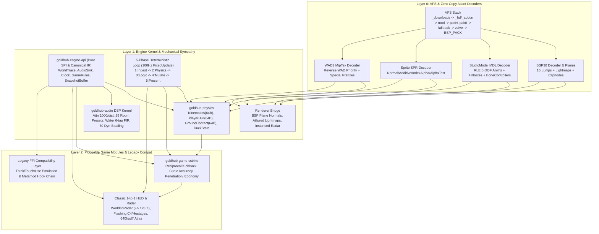

# Counter-Strike 1.6 Porting & GoldHub Engine Extraction Master Blueprint (DAG)

> **Architectural Standard**: Canonical IR as Single Source of Truth (SSOT)  
> **Execution Paradigm**: 5-Phase Deterministic Bevy ECS + SMA Monomorphic Pipelines + Legacy C-ABI Facade  
> **Memory Contract**: 64-byte Cache-Line Aligned Archetypes, Zero-Allocation Hot Paths, Per-Frame Bump Arenas  
> **Source Fidelity Baseline**: ReHLDS, ReGameDLL, cs16_goldsrc_client, Xash3D FWGS, Metamod-R, AMX Mod X  

---

## 1. Strategic Architecture: IR as Single Source of Truth

```
   ┌─────────────────────────────────────────────────────────────────────┐
   │                      LEGACY MODDING WORLD (C-ABI)                   │
   │   Metamod-R, AMX Mod X, ReHLDS Plugins, HLSDK DLLs, Classic Bots    │
   │   (edict_t*, entvars_t*, pfnThink, pfnTouch, pfnUse, EngFuncs)      │
   └──────────────────────────────────▲──────────────────────────────────┘
                                      │
                   ┌──────────────────┴──────────────────┐
                   │   Bidirectional Legacy FFI Facade   │
                   │   Pinned [edict_t; 2048] + DirtyBit │
                   └──────────────────▲──────────────────┘
                                      │ Translates to/from IR
                                      ▼
┌──────────────────────────────────────────────────────────────────────────┐
│                 CANONICAL DATA & COMMAND IR (SSOT)                       │
│  - State IR:   KinematicsIr, BoundsIr, CombatStateIr, DuckStateIr        │
│  - Command IR: EngineCommandIr (Think, Touch, Use, Fire, Sound, Decal)   │
│  - Asset IR:   MeshBuffer, StudioModelIr, SpriteSheetIr, CollisionTree   │
│  - Hook IR:    PreHook / PostHook -> HookVerdict (Supercede/Handled)     │
└─────────────────────────────────────▲────────────────────────────────────┘
                                      │
                   ┌──────────────────┴──────────────────┐
                   │   Native ECS Engine Bridge (SPI)    │
                   │   Monomorphic SMA, Zero-Alloc, SIMD │
                   └──────────────────▲──────────────────┘
                                      │
   ┌──────────────────────────────────▼──────────────────────────────────┐
   │                    MODERN HARDWARE ENGINE (GoldHub)                 │
   │  Bevy ECS, Vulkan/WGPU, 5-Phase Schedule, Rollback Snapshot Ring,   │
   │  Spatial Audio DSP, Frame Arena, Hardware-Friendly Cache Layouts    │
   └─────────────────────────────────────────────────────────────────────┘
```

---

## 2. Core Dependency DAG



---

## 3. Domain-by-Domain Source & Engineering Invariants

### Domain A: Physics & Movement (`pm_shared.cpp`, `sv_phys.cpp`)
- **Ducking (`pm_shared.cpp:1981-2214`)**:
  - `TIME_TO_DUCK = 0.4f`. Cubic Hermite spline `PM_SplineFraction(val) = 3v^2 - 2v^3`.
  - Eye height interpolates smoothly from `+28.0` (`PM_VEC_VIEW`) down to `+12.0` (`PM_VEC_DUCK_VIEW`).
  - Unduck (`PM_UnDuck`) checks solid ceiling clearance via `PM_PlayerTrace`; ReGameDLL anti-double-duck (`bInDuck` / `PLAYER_PREVENT_DDUCK`) suppresses 1-tick silent duck abuse. Smooth camera transition ensures zero abrupt snap.
- **Air Strafing & Bhop Cap (`pm_shared.cpp:1336-1374, 2587-2612`)**:
  - `PM_AirAccelerate` caps `wishspd` at `30.0`, preserving full `wishspeed` in `accelspeed` multiplier.
  - `PM_PreventMegaBunnyJumping`: when horizontal jump speed $> 1.2 \times \text{maxspeed}$, scales velocity by $(\frac{1.2 \times \text{maxspeed}}{\text{spd}}) \times 0.8$.
- **Ladders (`pm_shared.cpp:2218-2375`)**:
  - `MAX_CLIMB_SPEED = 200.0`, jump exit impulse `270.0 * trace.plane.normal`.
- **Brush Pushers (`sv_phys.cpp:470-810`)**:
  - `SV_PushRotate` transforms entity local coordinates via initial and transposed target basis matrices (`AngleVectors` / `AngleVectorsTranspose`), preserving negated right-axis sign (`-DotProduct(right, start)`), rolling back cleanly if blocked.

### Domain B: Weapons, Ballistics & Brass (`weapons.cpp`, `wpn_*.cpp`, `cbase.cpp`, `ev_common.cpp`)
- **Accuracy & Spread**:
  - Rifles cubic polynomial: `acc = (shots^3 / divisor) + base` (AK-47: divisor `200`, base `0.35`, clamp `1.25`; M4A1: divisor `220`, base `0.30`, clamp `1.0`).
  - Pistols time recovery (`wpn_deagle.cpp:111-123`): `acc -= (0.4 - dt) * 0.35`, clamped `[0.55..0.90]`.
  - Triangular random spread (`cbase.cpp:1337-1343`): `x = rand(-0.5..0.5) + rand(-0.5..0.5)`.
- **KickBack (`weapons.cpp:733-811`)**:
  - Lateral recoil direction flips with probability `1 / (direction_change + 1)`.
  - Client punchangle decay (`view.cpp:341-349`): `len -= (10.0 + len * 0.5) * frametime`.
- **Wall Penetration (`cbase.cpp:1268-1482`, `FireBullets3`)**:
  - Calibers: 9mm (`21`), .45 (`15`), .50AE (`30`), 5.56mm (`35`), 7.62mm (`39`), .338LM (`45`).
  - Material retention: Wood (`dmg * 0.6`), Concrete (`power * 0.25, dmg * 0.5`), Metal (`power * 0.15, dmg * 0.2`), Grate/Vent (`power * 0.5`).
  - Range attenuation: `damage *= pow(range_modifier, dist / 500.0)`.
- **Brass Casing Ejection (`ev_common.cpp:139-174`, `event_ak47.cpp:57-65`)**:
  - `fDirection = (rightScale > 0.0f) ? -1.0f : 1.0f`: when `cl_righthand 1` (`rightScale = +10`), shells eject **LEFT** (`-right`)!
  - Models: `models/pshell.mdl` (pistols, TMP, UMP45), `models/rshell.mdl` (rifles, SMGs, M249), `models/rshell_big.mdl` (AWP, Scout), `models/shotgunshell.mdl` (M3, XM1014).

### Domain C: VFS, Formats & BSP Lighting (`mod_bmodel.c`, `searchpath.c`)
- **BSP Plane Normals (`mod_bmodel.c:3362-3365`)**:
  - Face normals MUST come from `bsp.planes[face.plane_id]` inverted when `face.side != 0`. Never recompute from vertex triplets (avoids collinear T-junction normal inversion causing spot-light seams).
- **VFS Search Order**: `_downloads` -> `_addon/_hd/_lang` -> `<mod>/` -> `<mod>/pakN..0` -> `fallback` -> `valve/`. Map `wad` keyvalue resolved in reverse order.

### Domain D: Audio DSP & Spatialization (`s_main.c`, `s_mix.c`, `s_dsp.c`)
- **Distance Falloff**: `SND_CLIP_DISTANCE = 1000.0`, `gain = (1.0 - dist * attn / 1000.0).clamp(0.0, 1.0)`.
- **Channel Pool & Stealing**: 60 dynamic channels; protect `CHAN_VOICE` / `CHAN_STREAM` and client sounds; evict channel with minimum remaining playback duration.
- **DSP Environment**: 29 room presets (`s_roomtype`) + 6-tap FIR lowpass under water (`waterlevel > 2`).

### Domain E: Classic HUD, Radar & Scenario (`radar.cpp`, `flashlight.cpp`, `status_icons.cpp`)
- **Flashlight HUD (`flashlight.cpp:86-137`)**:
  - Top-right `x = ScreenWidth - 1.5 * Width`, `y = Height / 2`.
  - Split sprites: `flash_empty` (112, 25, 32x32), `flash_beam` (144, 25, 16x32), `flash_full` (160, 25, 32x32).
  - Battery crop: `iOffset = 32 * (1.0 - battery)`, shifts right, turns red (`RGB_REDISH`) below 20%.
- **Classic Radar (`radar.cpp:237-398, 636-695`)**:
  - Sprite `radar640.spr` (128x128) at top-left, radius `64.0`, scale `32.0 u/px`.
  - Elevation markers (`ΔZ = Z_player - Z_target`):
    - `|ΔZ| < 128`: `4x4` square dot;
    - `ΔZ <= -128` (target higher): `DrawT` (`T` / `▲`);
    - `ΔZ >= 128` (target lower): `DrawFlippedT` (`⊥` / `▼`);
    - Planted C4: `DrawCross` (`X`).

### Domain F: Entity Lifecycle & Legacy FFI Adapter (`sv_phys.cpp`, `cbase.cpp`, `meta_api.h`)
- **Think/Touch/Use Decoupling**: Inside Bevy ECS, replace callback vtables with `ActiveTimer` sparse queries, `ContactEvent` streams, and `InteractIntent` buses evaluated across 5 barrier-separated frame phases.
- **FFI Facade**: Pinned `[edict_t; 2048]` buffer synchronized lazily via 64-bit dirty bitmasks (`dirty_masks[idx]`) with `HookVerdict` (`Ignored`, `Handled`, `Override`, `Supercede`).

---

## 4. 5-Phase Execution Schedule

1. **Phase 1: Ingestion & Input** — Net packet ingest, `UserCmd` snapshot append, legacy dirty outbound capture.
2. **Phase 2: Physics & Movement** — FixedUpdate 100Hz integration, BSP hull traces, emitting `ContactEvent` (no despawns/HP mutations).
3. **Phase 3: Logic & GameRules** — Evaluate `CsWeaponSystem`, grenades, breakables, round rules, `Think` schedules, Metamod hooks.
4. **Phase 4: Mutation & Snapshot** — Structural entity spawns/despawns, `SnapshotBuffer` commit, FFI inbound sync.
5. **Phase 5: Presentation & Audio/HUD** — Interpolation, casing ejection particles, bullet sparks/decals, DSP spatial sound mixer, Classic Radar & HUD rendering.
